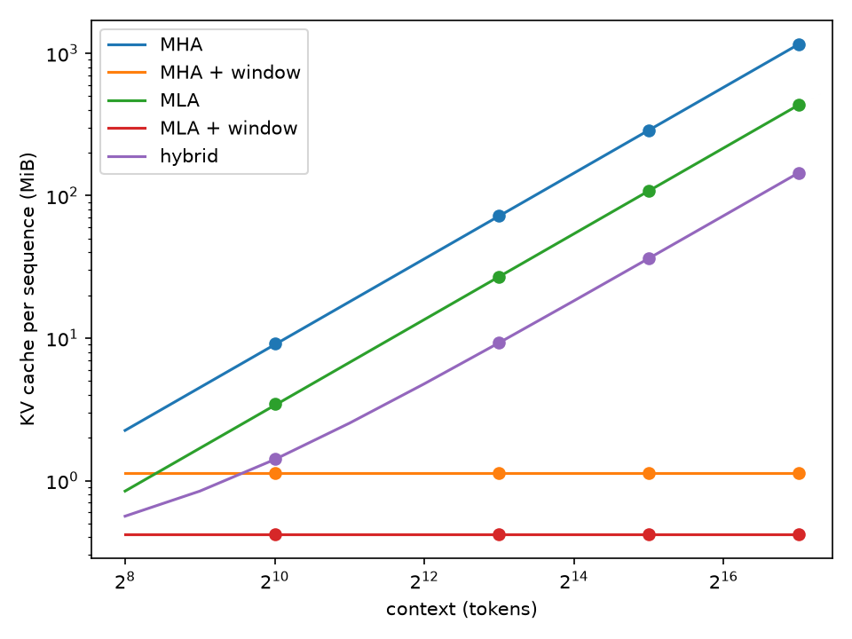
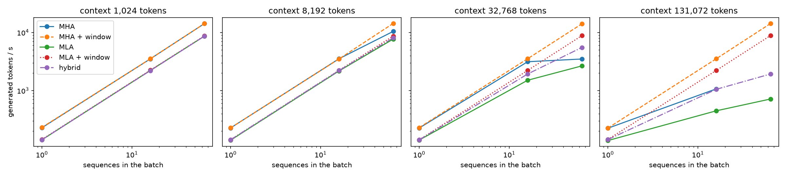
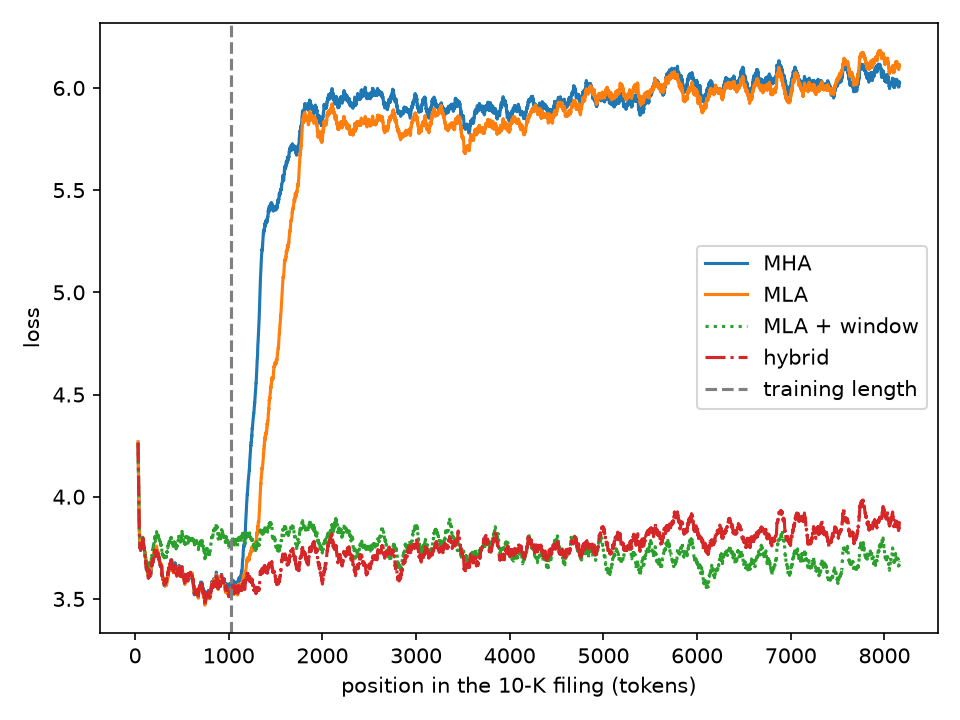

# Sliding window + latent attention in nanoGPT

## The problem

When a language model writes text, it produces one token at a time, and each new token has to look back at all the
previous ones. To avoid recomputing everything at every step, the model keeps in memory, for every token already
written and at every layer, two vectors: a key and a value. This memory is the **KV cache**.

The cache grows with the length of the text and with the number of users served at the same time. On a fixed GPU it
decides how many people the model can serve and how long their documents can be, and reading it at every step is what
makes generation slow.

## The two methods, in plain words

**Sliding window attention** ([Mistral 7B](https://arxiv.org/abs/2310.06825), Section 2). Each token looks only at the
last few tokens (the *window*, 128 here) instead of all the previous ones. The cache never holds more than the window,
so memory and time per generated token stop growing with the text. The price: a token cannot read anything older than
the window directly. Information can still travel further, one window per layer, but only indirectly.

**Multi-head latent attention, MLA** ([DeepSeek-V2](https://arxiv.org/abs/2405.04434), Section 2.1). Each token still
sees the whole text, but what is stored for it is much smaller. Instead of a key and a value for every attention head,
the model stores one short vector per token, from which the keys and values of all heads can be rebuilt. A rearrangement
of the matrix products (DeepSeek calls it *absorption*) means they never actually need to be rebuilt during generation.
The price: more arithmetic per generated token, and a separate small key to carry the position of each token, because
the usual way of encoding positions (RoPE) does not survive the rearrangement.

**The hybrid** combines them: MLA in every layer, and the window in two layers out of three. The third layer sees the
whole text. The windowed layers keep a fixed-size cache; the full layers keep a growing one, but compressed by MLA.
Domyn Edge has the same 2:1 ratio (24 windowed and 12 full layers out of 36), arranged differently: three windowed
layers for each full one, with extra full layers at the start and at the end.

## What I compared

A small GPT (6 layers, about 30 million parameters) in four versions that differ only in attention:

| version | each token looks at | stored per token, per layer |
|---|---|---|
| **MHA**, standard attention (baseline) | all previous tokens | 768 numbers (a key and a value for each of the 6 heads) |
| **MLA** | all previous tokens | 288 numbers (the short vector, 256, and the position key, 32) |
| **MLA + window** | the last 128 tokens | 288 numbers, for at most 128 tokens |
| **Hybrid** | the last 128 tokens in 4 layers, everything in 2 | 288 numbers |

Each version was trained from scratch three times (three random seeds). With the same seed, all versions see the same
text in the same order; the seed changes both the initial weights and the order of the text. The memory and speed
measurements also include **MHA + window**, which needs no training.

## Results at a glance

- **MLA keeps the quality of standard attention with a 2.7 times smaller cache.** But in plain PyTorch it generates
  tokens more slowly than standard attention, which runs as one fused FlashAttention kernel. MLA's rearranged
  computation has no such kernel in PyTorch (FlexAttention does not fit it, see [Generation speed](#generation-speed))
  and runs as separate matrix products. DeepSeek wrote one, [FlashMLA](https://github.com/deepseek-ai/FlashMLA), but it
  runs only on newer GPU architectures (Hopper or Blackwell) than that of the A100s I used (Ampere).
- **The window makes memory and time per token constant**, from 1,000 to 131,000 tokens of context. It costs some
  quality, more on long documents.
- **The hybrid has the quality of standard attention**, a cache 8 times smaller at long contexts, and it keeps working
  on texts eight times longer than it was trained on, where standard attention breaks down.

## How it is built

Everything is in [`model.py`](model.py). I started from [nanoGPT](https://github.com/karpathy/nanoGPT) for the
structure of the repository, and removed the files and functions the task did not need.

- **Positions.** nanoGPT learns one vector per position, which stops at the training length. All versions use RoPE
  instead, which rotates queries and keys by an angle that depends on the position. MLA needs it, and using it everywhere
  keeps the comparison about attention only.
- **The window in training** is a mask: scores outside the window are discarded. On GPU the mask goes to
  [FlexAttention](https://pytorch.org/blog/flexattention/), which skips the parts of the computation outside the window
  instead of computing them and throwing them away.
- **The window in generation** needs no mask: the cache of a windowed layer has exactly 128 slots and works as a ring,
  where each new token overwrites the oldest one.
- **MLA** follows the paper's equations one by one (the equation numbers are next to the layers in the code), with the
  paper's proportions: the short vector is four times a head (256), the position key half a head (32), shared by all
  heads, and there is a normalization after the short vector (Section 3.1.2). Queries are not compressed: in the paper
  that only saves memory during training. In training, keys and values are rebuilt from the short vectors once per text;
  in generation they are never built.
- **Generation** reads the prompt in one pass and then produces one token at a time from the cache. nanoGPT's original
  version recomputed the whole text at every new token. There is no sampling script: the tests and the speed benchmark
  drive the cache directly.

## How I know it is correct

The tests in [`tests/test_attention.py`](tests/test_attention.py) run in a few seconds on a laptop. The most important
one generates text token by token from the cache and checks that the result is identical to processing the whole text at
once, for every version. If the MLA rearrangement or the ring had a mistake, the two would differ. Other tests check
that a window as long as the text gives standard attention, that a token really cannot see beyond the window, that a full
layer of the hybrid can, and that FlexAttention, the path used on GPU, gives the same numbers as the simple one.

## Setup

- **Model:** 6 layers, 384 wide, 6 heads; 29.9M parameters with MHA, 30.5M with MLA.
- **Training:** 491M tokens of [FineWeb-Edu](https://huggingface.co/datasets/HuggingFaceFW/fineweb-edu) (7,500 steps of
  64 texts of 1,024 tokens) for every run. One A100 per run, about 25 minutes each, on CINECA's Leonardo,
  with PyTorch 2.14.

## How it is measured

A **sequence** is one text the model reads or writes, like one user's request; the tables also call it a text. Several
sequences processed together form a **batch**, like several users served at once. The **context** is how many tokens of
a sequence the model has already seen: during generation, how many tokens are in its cache.

**Memory and generation speed** ([`bench_decode.py`](bench_decode.py), on one A100). A generation step produces one new
token for every sequence in the batch: the new token goes through the six layers, each of which reads its cache, and
ends in a prediction over the whole vocabulary. I time this step at contexts of 1,024, 8,192, 32,768 and 131,072
tokens, with batches of 1, 16 and 64 sequences.

- The cache is set up as if the context had already been read: it has the right size and every step reads all of it,
  but it holds zeros instead of a real prompt, and the weights are random. Neither changes the cost of a step, so no
  training or real text is needed. Reading the prompt is not timed.
- Each measurement runs 3 warm-up steps, then averages the time of 20 steps, in plain PyTorch without compilation.
- *Milliseconds per step* is the time to produce one token for every sequence in the batch; *tokens per second* is the
  number of sequences divided by that time.
- *Memory* is the size of the cache the benchmark allocates, in bfloat16 (two bytes per number).

**Quality** ([`evaluate.py`](evaluate.py)). The loss measures how well the model predicts each token from the ones
before it: it is the average of minus the log of the probability the model gave to the right token, so lower is better.
Each sequence is read in one pass, as in training, and the loss is averaged over all its tokens.

- *FineWeb-Edu validation:* 2M tokens of the same kind of web text, never seen in training, cut into 1,951 sequences of
  1,024 tokens, the training length.
- *10-K annual reports:* the first 128 annual reports of US companies from 2020 (test split of
  [EDGAR-CORPUS](https://huggingface.co/datasets/eloukas/edgar-corpus)) that are at least 8,192 tokens long. Each model
  reads the first 1,024, 4,096 or 8,192 tokens of every report in one pass. It is a different kind of text, long
  documents where what was written pages earlier matters, and beyond 1,024 tokens longer than anything the models saw.
  The table gives the average over all the tokens read; the figure gives the average at each position.
- All 12 trained models are evaluated (4 versions × 3 seeds), and the tables give the mean over the seeds.

## Results

### Memory



*KV cache of one text against its length. Lines are the formula, dots are the cache allocated on the GPU by the speed benchmark.*

MLA stores 2.7 times less than MHA for every token; the window stops the cache at 128 tokens. Combined, the cache of
MLA + window is about 0.4 MiB per text, for all six layers, whatever the length of the text.

The difference decides what fits on a GPU. With 64 texts of 131,072 tokens each, standard attention would need 72 GiB of
cache and does not fit on a 64 GB A100. MLA needs 27 GiB, the hybrid 9 GiB, MLA + window 27 MiB.

### Generation speed



*Tokens generated per second on one A100, against the number of texts generated together. MHA has no point at
131,072 tokens and 64 texts: it runs out of memory.*

| milliseconds per generation step | MHA | MHA + window | MLA | MLA + window | hybrid |
|---|---|---|---|---|---|
| 1,024 tokens, 1 text | 4.4 | 4.3 | 7.1 | 7.0 | 7.1 |
| 131,072 tokens, 16 texts | 15.0 | 4.5 | 35.8 | 7.2 | 15.2 |
| 131,072 tokens, 64 texts | out of memory | 4.5 | 89.6 | 7.2 | 33.2 |

- **With the window, the time per step does not change** from 1,024 to 131,072 tokens, as promised.
- **At short contexts every step costs at least about 4.4 ms**, whatever the cache: with a model this small, most of
  that time is most likely the fixed cost of launching the many small GPU operations of six layers. MLA has more of
  them, hence about 7 ms.
- **At long contexts MLA is slower than MHA**, even though it reads a cache 2.7 times smaller. I profiled one step at
  131,072 tokens: MHA runs as a single FlashAttention kernel built for generation, which reads the cache once and keeps
  the intermediate scores on chip. MLA's rearranged computation runs as generic matrix products: it reads the short
  vectors twice (once for the scores, once for the output), writes the scores to GPU memory in between, and each product
  has only 6 rows, one per head, which leaves most of the GPU idle. FlexAttention would not fix this: to it, the
  rearranged MLA is one key shared by all 6 heads, 288 numbers wide, and PyTorch 2.14 uses its generation kernel only
  when the heads sharing a key are a power of two. Otherwise it handles each head separately, reading the shared cache
  once per head, and pads the width to 512 (this is from PyTorch's source code; I did not measure it). DeepSeek wrote
  dedicated kernels for this ([FlashMLA](https://github.com/deepseek-ai/FlashMLA)), but they need a newer GPU architecture
  (Hopper or Blackwell) than the A100's (Ampere).
  DeepSeek-V2 itself presents MLA as a saving in memory, which allows larger batches, not as a faster step.

### Quality

| loss (lower is better) | FineWeb-Edu validation | 10-K, first 1,024 tokens | 10-K, 4,096 | 10-K, 8,192 |
|---|---|---|---|---|
| MHA | 3.771 ± 0.002 | 3.65 | 5.16 | 5.58 |
| MLA | 3.777 ± 0.002 | 3.65 | 5.01 | 5.50 |
| MLA + window | 3.841 ± 0.004 | 3.80 | 3.79 | 3.74 |
| hybrid | 3.774 ± 0.004 | 3.65 | 3.68 | 3.75 |

*Mean of three seeds (± standard deviation). The models were trained on texts of 1,024 tokens; the 4,096 and 8,192
columns are longer than anything they saw.*

- **MLA is within 0.006 of MHA**: about three times the spread between seeds, so possibly a small real cost, but ten
  times smaller than the window's.
- **The window costs 0.07 on web text and 0.15 on the annual reports**, where earlier pages matter more. My window is
  aggressive: an eighth of the context, where Mistral uses half (4,096 of 8,192).
- **The hybrid recovers the full quality**: one full layer in three is enough.



*Loss at each position of the annual reports, averaged over the 128 filings and the three seeds.*

**Beyond the training length, standard attention breaks down.** After token 1,024 the loss of MHA and MLA jumps from
3.6 to about 6: RoPE presents them with distances between tokens they never saw in training. The window never looks more
than 128 tokens back, so a long text looks like a short one and its loss even improves a little. The hybrid holds up,
but less firmly: its full layers keep RoPE, and how much the loss rises at 8,192 tokens varies between seeds (+0.04 to
+0.19). Domyn Edge uses no position encoding at all in its full layers; this result suggests one reason, though I did
not test it.

### Training speed

One training step takes 161 ms with MHA, 169 with MLA (5% slower: it rebuilds keys and values, and its attention heads
are wider, 96 instead of 64), 160 with MLA + window and 164 with the hybrid. The window barely helps here, because at 1,024 tokens attention is only about 7%
of the computation; most of it goes into the final layer over the 50,000-word vocabulary and into the MLPs. The
saving appears when the context is much longer than the window, as in Mistral's 2× at 16,000 tokens.

## Advantages and drawbacks

| | advantages | drawbacks |
|---|---|---|
| **Sliding window** | Cache and time per token constant, whatever the length of the text. Keeps working on texts longer than the training ones. Saves computation in training when texts are much longer than the window. | Cannot use anything beyond layers × window directly. Loses some quality, more on long documents. The training saving needs special kernels and long texts. |
| **MLA** | Much smaller cache (2.7× here, 57× with DeepSeek-V2's 128 heads) with the same quality, while still seeing the whole text. Serves batches and contexts where standard attention runs out of memory. | Without a dedicated kernel, generation is slower than standard attention. More arithmetic per token and a more complex design (a separate position key, two ways of computing attention). Breaks down beyond the training length like standard attention. |
| **Hybrid** | The quality of standard attention, a cache 8× smaller at long contexts, and good behaviour beyond the training length. | The cache still grows with the text, through the full layers. Generation slows down with long texts, like MLA. Its behaviour beyond the training length varies between seeds. |

## Limitations

- The models are small. MLA's saving grows with the number of heads (it is about heads ÷ 2.25), so 6 heads show only
  a fraction of it.
- One training length and one budget (491M tokens, about 16 per parameter); three seeds per version.
- Speeds are measured with plain PyTorch operations; a dedicated MLA kernel would change the generation results.
- A window of one eighth of the context is harsher than Mistral's one half.

## Running it

```bash
pip install -r requirements.txt
python -m pytest -q tests                  # correctness, a few seconds on CPU

python data/fineweb_edu/prepare.py         # 1B training tokens and 2M validation tokens
python data/edgar/prepare.py               # 128 long annual reports, for evaluation only

python train.py --attn=mha --out_dir=out/mha                                     # standard attention
python train.py --attn=mla --out_dir=out/mla                                     # MLA
python train.py --attn=mla --window=128 --out_dir=out/mla_swa                    # MLA + window
python train.py --attn=mla --window=128 --global_every=3 --out_dir=out/hybrid    # hybrid
# --seed=2 and --seed=3, with out_dir out/<version>_s2 and _s3, for the other seeds

python evaluate.py --device=cuda           # the 12 checkpoints: 4 versions x 3 seeds
python bench_decode.py --device=cuda '--contexts=[1024,8192,32768,131072]' '--batches=[1,16,64]'
python plots.py
```

The raw results are in [`results/`](results), the figures in [`figures/`](figures).
